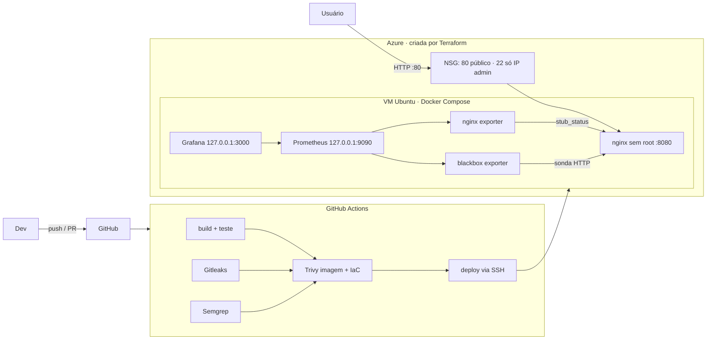

# Alaga Alerta — MVP publicado por pipeline DevSecOps

FIAP · Engenharia de Software 4º ano · Global Solution 2026.2 · CitizenTech · Disciplina Secure DevOps & Cloud (Produção).

| Item | Link |
| --- | --- |
| URL pública do MVP | _preencher com o output `url_site` do Terraform_ |
| Repositório | _preencher_ |
| Pipeline (Actions) | _preencher_ |
| Vídeo do pitch | _preencher_ |

## Ficha Técnica do MVP

| Campo | Descrição |
| --- | --- |
| **Produto** | Alaga Alerta: alerta de alagamento por bairro, em tempo útil. |
| **Público e território** | Moradores e motoristas de bairros com histórico de alagamento (exemplo: Vila Maria, São Paulo). |
| **Problema** | Os alertas de chuva são genéricos e chegam tarde. Falta um dado local, em tempo real, de quanto a água subiu e com que velocidade. |
| **Proposta de valor** | Avisar, por bairro e em tempo útil, quando uma rua está prestes a alagar e o que fazer. |
| **Componentes** | Sensor ESP32 (HC-SR04, MQ-2, DHT22) · Big Data (Bronze/Prata/Ouro) · API central · LLM local com RAG · Visão · RPA · Front com mapa do bairro · **Produção (esta entrega): containers, Terraform, GitHub Actions e observabilidade**. |
| **ODS** | Primários: 11 e 13. Secundários: 3 e 9. |
| **Este MVP** | Página pública publicada por container, Terraform e pipeline com varredura de segurança. A API central e o front completo estão nos repositórios dos outros integrantes. |

**Equipe:** Manoella Herrerias Waideman (RM 98906) · Felipe Capriotti da Silva Santos (RM 98460) · Victor Hugo Andrade (RM 550996) · Gustavo Kawamura Christofani (RM 99679).

## Identidade visual

Azul petróleo `#10283B` (fundo), ciano água `#4FD1E0` (destaque) e os estados **NORMAL** `#3FB58A`, **ATENCAO** `#F5B041` e **PERIGO** `#C0392B`, sempre com texto junto da cor. A mesma paleta vale para o site, o dashboard e os documentos. As cores do site ficam em `style.css`.

## Nomes internos

O produto se chama Alaga Alerta, mas recursos técnicos mantêm o prefixo `meu-app` (containers, grupo de recursos e NSG na Azure, arquivo do dashboard, nome da chave de state). Renomear exige recriar a infraestrutura; se for fazer, altere em conjunto `docker-compose.yml`, `infra/main.tf`, `.github/workflows/devsecops.yml` (comandos `az` do job `deploy`) e `observabilidade/`.

## Arquitetura



| Camada | Tecnologia | Arquivo |
| --- | --- | --- |
| Site | HTML/CSS estático em nginx sem privilégio | `index.html`, `style.css`, `conf.d/default.conf` |
| Container | Dockerfile enxuto, uid 101, sem segredo; compose com FS somente leitura, `cap_drop: ALL` | `Dockerfile`, `docker-compose.yml` |
| IaC | Terraform azurerm: RG, VNet, NSG, IP público, VM | `infra/` |
| Pipeline | GitHub Actions: build, Gitleaks, Semgrep, Trivy, deploy | `.github/workflows/devsecops.yml` |
| Observabilidade | Prometheus, Grafana, nginx exporter, blackbox exporter | `observabilidade/` |

## Segurança

| Controle | Como |
| --- | --- |
| Sem segredo na imagem | `.dockerignore` exclui `.env`; o compose recusa subir sem `GRAFANA_ADMIN_PASSWORD`. |
| Segredos no CI | Só em GitHub Secrets (`VM_HOST`, `VM_SSH_KEY`, `GRAFANA_ADMIN_PASSWORD`). Gitleaks barra vazamento. |
| Imagem | Usuário não root, `apk upgrade`, Trivy (HIGH/CRITICAL) bloqueando o deploy. |
| Código e IaC | Semgrep (Dockerfile, Terraform, GitHub Actions) e Trivy config. |
| Nuvem | State e `.tfvars` fora do repo (`.gitignore`). `admin_cidr` rejeita `0.0.0.0/0`: a porta admin nunca fica aberta ao mundo. |
| Exceção registrada | A porta 80 é pública de propósito (URL pública do MVP), justificada em `.trivyignore`. Prometheus e Grafana só em `127.0.0.1`; a porta de métricas do nginx (8081) não é publicada. |
| Cabeçalhos HTTP | CSP restritiva, `nosniff`, `X-Frame-Options: DENY`, `server_tokens off`. |
| Sensor | A chave `X-Device-Key` real vai só para GitHub Secrets e ambiente; `dev-key-demo` é placeholder de demonstração. |

> A URL pública precisa ter certificado válido para o sensor enviar por HTTPS. Hoje o deploy expõe só HTTP na porta 80; fechar domínio e certificado com o time da API (pendente).

## Observabilidade: as 4 métricas de ouro

Dashboard **"Alaga Alerta — 4 métricas de ouro"** no Grafana.

| Métrica | Fonte | Métrica Prometheus |
| --- | --- | --- |
| Latência | blackbox (sonda HTTP) | `probe_duration_seconds`, `probe_http_duration_seconds` |
| Tráfego | nginx exporter | `rate(nginx_http_requests_total[1m])` |
| Erros | blackbox | `probe_success`, `probe_http_status_code` |
| Saturação | nginx exporter | `nginx_connections_active`, `nginx_connections_waiting` |

Alertas (`observabilidade/alertas.yml`): `SiteForaDoAr`, `NginxSemMetricas`, `LatenciaAlta`, `ConexoesAltas`.
Para disparar um: `docker stop meu-app-web`. Em 1 a 2 minutos `SiteForaDoAr` fica *firing* em Prometheus (`/alerts`) e no painel "Alertas disparando" do Grafana. Depois, `docker start meu-app-web`.

Prometheus e Grafana também podem rodar localmente apontando para o MVP publicado: troque o alvo do job `site` em `observabilidade/prometheus.yml` pela URL pública (e remova o job `nginx`, que só existe dentro da VM).

Ainda não existe alerta de regra de negócio (classe `PERIGO` ou sensor sem leitura por mais de 60 s): depende de a API central expor essas métricas.

## Responsabilidade compartilhada

| Item | Microsoft Azure | Equipe |
| --- | --- | --- |
| Datacenter, hardware, hypervisor, rede física | ✔ | |
| Disponibilidade da plataforma (IaaS) | ✔ | |
| Sistema operacional da VM (patches, hardening) | | ✔ |
| Regras de firewall (NSG) | | ✔ (Terraform) |
| Docker, imagens e dependências | | ✔ (Trivy no pipeline) |
| Código, segredos e chaves SSH | | ✔ (GitHub Secrets, Gitleaks) |
| Dados pessoais e LGPD | | ✔ |
| Monitoramento e resposta a alertas | | ✔ |

## Dados pessoais (LGPD)

- **Esta página** não coleta nem armazena dado pessoal: é HTML estático, sem formulário, cookie ou rastreador, e os logs do nginx não são exportados. Os únicos nomes e RMs exibidos são os da própria equipe.
- **Sensor:** não envia dado pessoal, só nível, gás, temperatura, umidade, hora e posição do ponto de instalação.
- **Produto completo:** dados pessoais, se existirem, ficam no cadastro de usuários do MVP (alertas por bairro). _Pendente: confirmar com o time da API quais dados são coletados, onde ficam e por quanto tempo, e então descrever a proteção (hash, retenção, anonimização)._

## Estimativa de custo (Azure, Brazil South, 24×7)

Valores **aproximados**; confirme na [calculadora da Azure](https://azure.microsoft.com/pricing/calculator/).

| Recurso | Configuração | US$/mês |
| --- | --- | --- |
| VM Linux | Standard_B1ms (1 vCPU, 2 GiB) | 20–25 |
| Disco do SO | 30 GB Standard SSD | 3–4 |
| IP público | Standard, estático | 3–4 |
| Rede de saída | tráfego baixo | ~0 |
| GitHub Actions, Prometheus, Grafana | repo público / rodam na VM | 0 |
| **Total** | | **≈ 26–33** |

Em uma ou duas semanas de avaliação, cerca de US$ 6–15. `terraform destroy` zera a cobrança.

## Como reproduzir

**Local:**

```bash
cp .env.example .env            # defina GRAFANA_ADMIN_PASSWORD
docker compose up -d --build
# site http://localhost · Prometheus http://localhost:9090 · Grafana http://localhost:3000 (admin)
```

**Nuvem:**

```bash
cd infra
cp terraform.tfvars.example terraform.tfvars   # subscription_id, admin_cidr (seu IP /32), chave SSH, repo_url
terraform init -backend-config="resource_group_name=..." -backend-config="storage_account_name=..." \
               -backend-config="container_name=tfstate" -backend-config="key=meu-app-web.tfstate"
terraform apply
```

O output `url_site` é a URL pública. A VM clona o repo em `~/app`; entre por SSH uma vez, crie o `.env` e rode `docker compose up -d --build`. Depois cadastre os secrets `AZURE_CREDENTIALS`, `VM_HOST`, `VM_SSH_KEY` e `GRAFANA_ADMIN_PASSWORD` e o environment `producao`: cada push na `main` testa, escaneia e faz o deploy.

**Pipeline barrado e corrigido:** commite um segredo falso (ex.: `aws_secret_access_key = wJalrXUtnFEMI/K7MDENG/bPxRfiCYEXAMPLEKEY`) numa branch. O job Gitleaks falha e nada é publicado. Remova o segredo e o pipeline fica verde. Guarde os links das duas execuções e os prints para o PDF.
